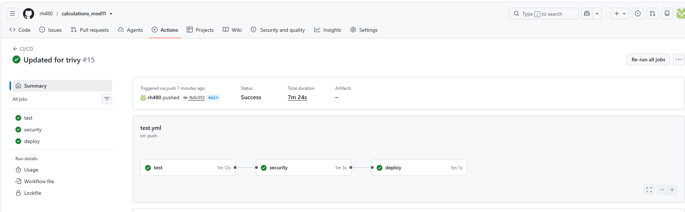

# Module 11

GitHub URL:
https://github.com/rh480/calculations_mod11


Dockerhub URL: 
https://hub.docker.com/repository/docker/rh48/601_module11/general

Screenshots:




# Reflection
In this module, I learned a lot more about database development. I learned about how the calculator can be structured to use SQLAcademy and how to use Pydantic schemas to validate the data before it is stored. With SQLAlchemy I used single table inheritance so all the calculations share one table and there is a column that decides what subclass the query returns. I also learned how to associate calculations to a user using a foreign key. Pydantic also helped to validate the inputs by checking if they are valid such as not accepting non-numeric inputs, and blocking division by zero. I also struggled when some tests failed because the schema only accepted “addition” but the factory accepted “add” so it resulted in an error. I had to make sure there was a validator so all the names match and both are accepted. Unit tests were used to cover the factory and schemas and the integration test created the rows in PostgreSQL and checked invalid foreign keys. I also had to fix the GitHub actions tests and update a lot of other things to make sure everything passed. I struggled with Trivy again but I was able to get it to work by updating the requirements.txt and adding a trivyignore again. I also struggled with the CI because it broke in my virtual environment due to cache. I was finally able to fix everything and get it to run properly. One of my biggest issues was debugging the environment. I kept running into connection errors with different causes such as variable issues and port and conflicts from previous leftover Compose containers. I learned a lot from what each error meant and how to fix the configuration so it worked. 


# 📦 Project Setup

---

# 🧩 1. Install Homebrew (Mac Only)

> Skip this step if you're on Windows.

Homebrew is a package manager for macOS.  
You’ll use it to easily install Git, Python, Docker, etc.

**Install Homebrew:**

```bash
/bin/bash -c "$(curl -fsSL https://raw.githubusercontent.com/Homebrew/install/HEAD/install.sh)"
```

**Verify Homebrew:**

```bash
brew --version
```

If you see a version number, you're good to go.

---

# 🧩 2. Install and Configure Git

## Install Git

- **MacOS (using Homebrew)**

```bash
brew install git
```

- **Windows**

Download and install [Git for Windows](https://git-scm.com/download/win).  
Accept the default options during installation.

**Verify Git:**

```bash
git --version
```

---

## Configure Git Globals

Set your name and email so Git tracks your commits properly:

```bash
git config --global user.name "Your Name"
git config --global user.email "your_email@example.com"
```

Confirm the settings:

```bash
git config --list
```

---

## Generate SSH Keys and Connect to GitHub

> Only do this once per machine.

1. Generate a new SSH key:

```bash
ssh-keygen -t ed25519 -C "your_email@example.com"
```

(Press Enter at all prompts.)

2. Start the SSH agent:

```bash
eval "$(ssh-agent -s)"
```

3. Add the SSH private key to the agent:

```bash
ssh-add ~/.ssh/id_ed25519
```

4. Copy your SSH public key:

- **Mac/Linux:**

```bash
cat ~/.ssh/id_ed25519.pub | pbcopy
```

- **Windows (Git Bash):**

```bash
cat ~/.ssh/id_ed25519.pub | clip
```

5. Add the key to your GitHub account:
   - Go to [GitHub SSH Settings](https://github.com/settings/keys)
   - Click **New SSH Key**, paste the key, save.

6. Test the connection:

```bash
ssh -T git@github.com
```

You should see a success message.

---

# 🧩 3. Clone the Repository

Now you can safely clone the course project:

```bash
git clone <repository-url>
cd <repository-directory>
```

---

# 🛠️ 4. Install Python 3.10+

## Install Python

- **MacOS (Homebrew)**

```bash
brew install python
```

- **Windows**

Download and install [Python for Windows](https://www.python.org/downloads/).  
✅ Make sure you **check the box** `Add Python to PATH` during setup.

**Verify Python:**

```bash
python3 --version
```
or
```bash
python --version
```

---

## Create and Activate a Virtual Environment

(Optional but recommended)

```bash
python3 -m venv venv
source venv/bin/activate   # Mac/Linux
venv\Scripts\activate.bat  # Windows
```

### Install Required Packages

```bash
pip install -r requirements.txt
```

---

# 🐳 5. (Optional) Docker Setup

> Skip if Docker isn't used in this module.

## Install Docker

- [Install Docker Desktop for Mac](https://www.docker.com/products/docker-desktop/)
- [Install Docker Desktop for Windows](https://www.docker.com/products/docker-desktop/)

## Build Docker Image

```bash
docker build -t <image-name> .
```

## Run Docker Container

```bash
docker run -it --rm <image-name>
```

---

# 🚀 6. Running the Project

- **Without Docker**:

```bash
python main.py
```

(or update this if the main script is different.)

- **With Docker**:

```bash
docker run -it --rm <image-name>
```

---

# 📝 7. Submission Instructions

After finishing your work:

```bash
git add .
git commit -m "Complete Module X"
git push origin main
```

Then submit the GitHub repository link as instructed.

---

# 🔥 Useful Commands Cheat Sheet

| Action                         | Command                                          |
| ------------------------------- | ------------------------------------------------ |
| Install Homebrew (Mac)          | `/bin/bash -c "$(curl -fsSL https://raw.githubusercontent.com/Homebrew/install/HEAD/install.sh)"` |
| Install Git                     | `brew install git` or Git for Windows installer |
| Configure Git Global Username  | `git config --global user.name "Your Name"`      |
| Configure Git Global Email     | `git config --global user.email "you@example.com"` |
| Clone Repository                | `git clone <repo-url>`                          |
| Create Virtual Environment     | `python3 -m venv venv`                           |
| Activate Virtual Environment   | `source venv/bin/activate` / `venv\Scripts\activate.bat` |
| Install Python Packages        | `pip install -r requirements.txt`               |
| Build Docker Image              | `docker build -t <image-name> .`                |
| Run Docker Container            | `docker run -it --rm <image-name>`               |
| Push Code to GitHub             | `git add . && git commit -m "message" && git push` |

---

# 📋 Notes

- Install **Homebrew** first on Mac.
- Install and configure **Git** and **SSH** before cloning.
- Use **Python 3.10+** and **virtual environments** for Python projects.
- **Docker** is optional depending on the project.

---

# 📎 Quick Links

- [Homebrew](https://brew.sh/)
- [Git Downloads](https://git-scm.com/downloads)
- [Python Downloads](https://www.python.org/downloads/)
- [Docker Desktop](https://www.docker.com/products/docker-desktop/)
- [GitHub SSH Setup Guide](https://docs.github.com/en/authentication/connecting-to-github-with-ssh)
